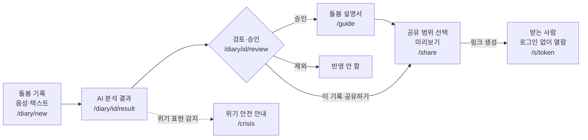
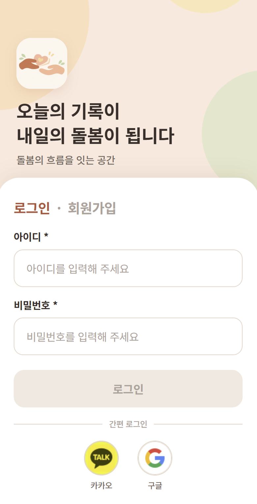
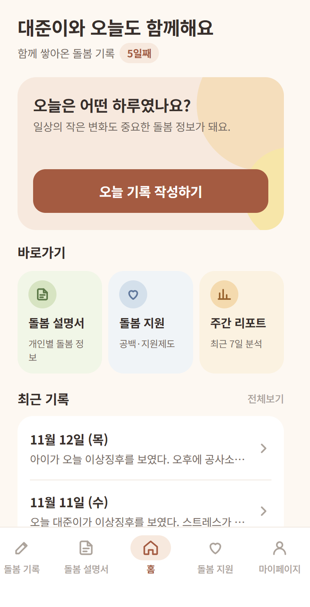
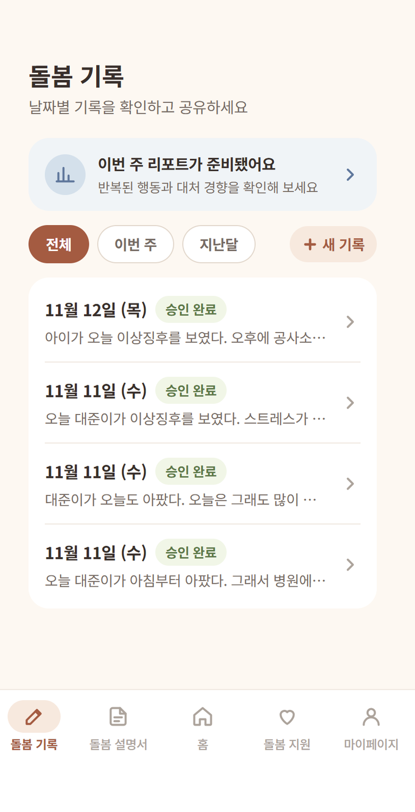
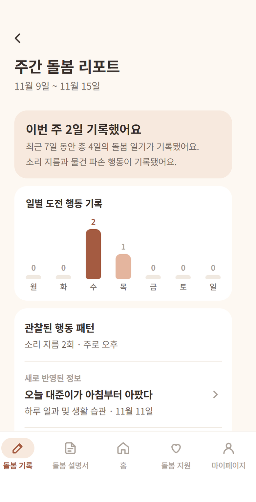

<p align="center">
  
</p>

# 돌봄바통 (Dolbom Baton) — Frontend

[](https://github.com/yongyong-18team/frontend/actions/workflows/e2e.yml)
[](https://github.com/yongyong-18team/frontend/actions/workflows/deploy.yml)


> **오늘의 돌봄을 기록하고, 다음 돌봄으로 이어주는 AI 기반 발달장애인 돌봄 지원 서비스**
>
> 보호자가 쓰는 모바일 웹입니다. 돌봄을 음성이나 텍스트로 기록하고, AI가 정리한 정보를 승인해 돌봄 설명서를 만들고, 링크 하나로 다음 돌봄 제공자에게 넘겨줍니다.

2026 용용톤 복지 트랙 출품작입니다. 시설·지원제도는 실제 용인시 공공데이터를 쓰고, 시연에 쓰는 대상자·돌봄 기록은 개인정보 보호를 위해 지어낸 데이터만 씁니다.

| 바로가기 | |
|---|---|
| 서비스 (모바일 웹) | https://yongyong-18team-frontend.vercel.app |
| 서비스 소개 | [yongyong-18team](https://github.com/yongyong-18team) 조직 페이지 |
| 백엔드 · 설계 문서 | [yongyong-18team/backend](https://github.com/yongyong-18team/backend) |
| API 문서 (Swagger UI) | https://batong-team18.duckdns.org/swagger-ui/index.html |


**육룡이 나르샤팀** · PM [xofkd009](https://github.com/xofkd009) · FE [Sehoon-Jeong](https://github.com/Sehoon-Jeong), [imly-dia](https://github.com/imly-dia) · BE [parkc31](https://github.com/parkc31), [wonnbu](https://github.com/wonnbu), [Hyunsuk305](https://github.com/Hyunsuk305)

---

## 목차

- [핵심 흐름](#핵심-흐름)
- [화면 소개](#화면-소개)
- [주요 화면](#주요-화면)
- [역할에 따라 달라지는 화면](#역할에-따라-달라지는-화면)
- [프론트에서 고민한 부분](#프론트에서-고민한-부분)
- [기술 스택](#기술-스택)
- [로컬 실행](#로컬-실행)
- [테스트](#테스트)
- [배포](#배포)
- [폴더 구조](#폴더-구조)
- [협업 방식](#협업-방식)
- [현재 상태](#현재-상태)
- [알려진 한계](#알려진-한계)
- [문서](#문서)
- [팀](#팀)

## 핵심 흐름



- **AI는 제안만 하고, 반영은 보호자가 결정합니다.** 분석 결과는 항목마다 승인·제외·수정을 고르는 검토 화면을 거쳐야 설명서에 들어갑니다.
- **공유는 보호자가 범위를 고릅니다.** 문서 유형과 공개할 섹션을 직접 고르고 미리보기로 확인한 뒤 링크를 만듭니다.
- **받는 사람은 앱 설치나 로그인 없이 링크로 엽니다.**
- **위기 표현이 감지되면** 분석 결과 대신 긴급 안전 안내(`/crisis`)로 바뀝니다.

## 화면 소개

<table>
  <tr>
    <td align="center" valign="top"></td>
    <td align="center" valign="top"></td>
    <td align="center" valign="top"></td>
    <td align="center" valign="top"></td>
  </tr>
  <tr>
    <td align="center"><b>로그인 · 회원가입</b><br><code>/login</code></td>
    <td align="center"><b>홈</b><br><code>/home</code></td>
    <td align="center"><b>돌봄 기록</b><br><code>/diary</code></td>
    <td align="center"><b>주간 리포트</b><br><code>/report</code></td>
  </tr>
  <tr>
    <td align="center" valign="top"></td>
    <td align="center" valign="top"></td>
    <td align="center" valign="top"></td>
    <td align="center" valign="top"></td>
  </tr>
  <tr>
    <td align="center"><b>돌봄 설명서</b><br><code>/guide</code></td>
    <td align="center"><b>공유</b><br><code>/share</code></td>
    <td align="center"><b>돌봄 지원</b><br><code>/support</code></td>
    <td align="center"><b>마이페이지</b><br><code>/settings</code></td>
  </tr>
</table>

> 윗줄(로그인·홈·돌봄 기록·주간 리포트)은 실제 서비스 화면, 아랫줄(돌봄 설명서·공유·돌봄 지원·마이페이지)은 Figma 디자인 기준입니다. 이름·연락처·기록 내용은 모두 가상 데이터입니다.

### 로그인 · 온보딩 `/login` · `/onboarding`

계정을 만들고, 돌볼 대상자와 초기 돌봄 정보를 등록합니다.

- **로그인·회원가입(0.1):** 아이디 중복 확인 후 가입합니다. 로그인하면 대상자가 있으면 홈으로, 받은 초대가 있으면 초대 확인으로, 둘 다 없으면 온보딩으로 갑니다.
- **온보딩(0.2-1\~0.2-4):** 보호자 정보 → 대상자 정보 → 돌봄 프로필 질문 5개 → 확인·동의 순서입니다. 질문 답변은 음성으로도 입력할 수 있습니다.
- 입력은 브라우저에만 임시 보관했다가 마지막 "등록 완료"에서 한 번에 저장합니다. 앞 단계로 돌아가도 입력이 남아 있습니다.
- 필수 동의를 모두 확인해야 등록할 수 있고, 등록하면 초기 돌봄 설명서가 만들어집니다.
- API: `AUTH-01~03`, `TERMS-01`, `ONB-01`, `STT-01`

### 홈 `/home`

오늘의 기록을 시작하고 주요 기능으로 이동하는 첫 화면입니다.

- **오늘 기록 카드:** 오늘 기록 여부에 따라 문구와 버튼이 바뀝니다.
- **바로가기:** 돌봄 설명서, 돌봄 지원, 주간 리포트.
- **최근 기록:** 주 보호자는 일기 미리보기와 검토 대기 표시를 보고, 누르면 검토 화면으로 갑니다. 공동 관리자는 원문 대신 반영된 항목 수를 보고, 누르면 일일 기록 상세로 갑니다.
- 받은 초대가 있으면 맨 위에 알려 줍니다.
- API: `HOME-01`

### 돌봄 기록 `/diary`

매일의 돌봄을 기록하고, AI가 정리한 정보를 보호자가 검토해 설명서에 반영합니다.

- **작성(2.1):** 음성(최대 3분) 또는 텍스트로 씁니다. 음성은 글로 바꾼 뒤 보호자가 확인·수정하고, 원본 음성은 저장하지 않습니다.
- **AI 분석 결과(2.2):** 공감 한 줄과 추출된 항목을 보여 줍니다. 추출할 내용이 없으면 안내하고, 위기 표현이 감지되면 결과 대신 안전 안내(`/crisis`)로 갑니다.
- **검토·승인(2.3):** 항목마다 승인·제외·수정을 고릅니다. 승인한 항목만 설명서에 반영되고, 바꾼 내용이 있으면 나가기 전에 확인합니다.
- **목록(2.4):** 날짜별 기록과 검토 상태를 보고 기간(전체·이번 주·지난달)으로 걸러 봅니다.
- **공동 관리자:** 같은 탭에서 설명서에 반영된 기록만 봅니다. 일기 원문과 작성·삭제 버튼은 보이지 않습니다.
- **일일 기록 공유:** 승인된 항목이 있는 기록에서 "이 기록 공유하기"를 누르면 공유 범위 설정으로 이어집니다.
- 쓰다가 로그인이 만료돼도 다시 로그인하면 쓰던 글이 남아 있습니다.
- API: `STT-01`, `DIARY-01~05`, `ITEM-01`, `REPORT-01·02`

### 주간 리포트 `/report`

최근 7일의 기록을 모아 변화를 한눈에 보여 줍니다.

- 기록한 날 수와 요약 문장, 일별 도전 행동 그래프.
- **관찰된 행동 패턴:** 반복된 행동과 자주 나타난 시간대.
- **새로 반영된 정보:** 이 기간에 설명서에 들어간 항목. 누르면 그 기록으로 갑니다.
- 주간 리포트 공유는 서버가 아직 지원하지 않아 버튼을 숨겨 두었습니다.
- API: `REPORT-03`

### 돌봄 설명서 `/guide`

보호자가 승인한 돌봄 정보가 7개 섹션으로 쌓이는 설명서입니다.

- **조회(3.1):** 긴급 카드(이름·나이·비상 연락처·절대 금지 등)와 섹션별 카드. 카드를 누르면 항목과 날짜를 펼쳐 봅니다.
- **편집(3.2):** 기본 정보(이름·출생 연도·지역·비상 연락처)와 항목을 추가·수정·삭제한 뒤 한 번에 저장합니다.
- 상세에서 "이 항목 편집하기"를 누르면 그 섹션이 선택된 채로 편집이 열립니다.
- 저장하지 않고 나가면 확인 팝업을 띄웁니다.
- API: `GUIDE-01~04`, `SUBJ-02·03`

### 공유 `/share` · `/s/[token]`

보호자가 고른 정보만 링크 하나로 다음 돌봄 제공자에게 넘깁니다.

- **공유 범위(4.1):** 공개할 섹션을 직접 고릅니다. 내용 있는 섹션은 기본 선택, 비상 연락처는 기본 OFF입니다.
- **미리보기(4.2):** 받는 사람이 볼 화면 그대로 확인합니다. 이 미리보기가 고정본이 됩니다.
- **링크 발급·내역(4.3):** 링크는 7일 동안 열리고, 주소는 발급 화면에서 한 번만 보여 줍니다. 공유 내역에서 언제든 접근을 중지할 수 있습니다.
- **받는 사람 화면(4.4):** 로그인·앱 설치 없이 열립니다. 검색 노출 방지(`noindex`)와 주소 전달 방지(`no-referrer`)를 적용했고, 만료·중지·잘못된 링크는 각각 다른 안내를 보여 줍니다.
- 일기 원문과 보호자 감정 기록은 공유되지 않습니다.
- 이번 버전은 **돌봄 설명서와 일일 기록 공유**가 열려 있습니다. 일일 기록은 기록 화면의 "이 기록 공유하기"로 들어왔을 때 선택됩니다. 주간 리포트는 화면에 보이지만 선택할 수 없고, `ShareScopeView.tsx`의 `ENABLED_TYPES`에 추가하면 열립니다.
- API: `SHARE-01~05`, `PUB-01`

### 돌봄 지원 `/support`

용인시 돌봄시설과 지원제도를 조건별로 찾습니다.

- **찾기(5.1):** 돌봄 유형(단기/장기)과 필요한 날짜, 지역을 고릅니다. 지역은 대상자 등록 지역으로 채워집니다.
- **결과(5.2):** 전체 / 시설 / 제도로 나눠 봅니다. 단기 돌봄 시설이 없으면 시설을 억지로 추천하지 않고 관련 제도와 문의처를 안내합니다.
- **상세(5.3):** 지원 대상·내용·신청 방법과 전화·공식 안내 링크. 값이 없는 칸은 "기관에 문의" 안내를 보여 주고, 전화·주소·URL이 없으면 숨깁니다. 제도는 종류별 아이콘으로 구분합니다.
- **보호자 휴식 안내(5.4):** 진단처럼 들리는 표현을 피하고, 이용할 수 있는 휴식·상담 제도로 연결합니다.
- API: `RES-01·02`, `SUP-01`

### 마이페이지(설정) `/settings`

가족 또는 기타 보호자와 함께 돌볼 수 있도록 공동 관리자를 초대하고 관리합니다.

- **마이페이지(6.1):** 내 정보, 공동 관리자 목록, 대기 중인 초대. 로그아웃·탈퇴는 확인 팝업을 거칩니다.
- **초대(6.2):** 주 보호자만 초대할 수 있습니다. 아이디로 계정을 확인한 뒤 초대하고, 본인·중복 초대는 막습니다.
- **받은 초대(6.2.1):** 수락하면 그 대상자로 바로 전환됩니다.
- **관리(6.3):** 해제하면 그 사람이 만든 공유 링크도 서버에서 함께 중지됩니다.
- 공동 관리자는 설명서 조회·공유·지원 정보만 볼 수 있고, 일기 원문은 볼 수 없습니다.
- API: `USER-01·03`, `MEMBER-01~03`, `INVITE-01~06`

### 위기 안전 안내 `/crisis`

위기 표현이 감지되거나 돌봄 지원에서 "긴급 상황 도움받기"를 누르면 열립니다.

- 109, 1577-0199, 119, 112를 상황별로 안내하고, 누르면 바로 전화가 걸립니다.
- 연락처를 화면에 먼저 띄우고 서버 응답으로 바꾸기 때문에, 서버가 실패해도 연락처는 보입니다.
- 보호자 상담·휴식 지원 제도로 이어집니다.
- API: `SUP-02`

## 주요 화면

| 경로 | 화면 |
|---|---|
| `/login`, `/onboarding` | 로그인·회원가입, 보호자·대상자·돌봄 프로필 등록(4단계) |
| `/home` | 오늘의 기록, 바로가기, 최근 기록 |
| `/diary` | 음성·텍스트 돌봄 기록, AI 분석 결과 검토·승인, 기록 목록, 일일 기록 |
| `/guide` | 돌봄 설명서 조회·수정 |
| `/report` | 주간 돌봄 리포트 |
| `/share` | 공유할 문서·섹션 선택, 미리보기, 링크 발급, 공유 내역과 접근 중지 |
| `/s/[token]` | 받은 사람이 로그인 없이 보는 공유 페이지 |
| `/support` | 조건별 용인시 돌봄시설·지원제도 찾기 |
| `/crisis` | 위기 표현 감지 시 안전 안내 |
| `/settings` | 계정, 공동 관리자 초대·관리 |

첫 주소(`/`)는 홈으로 가고, 로그인 전이면 로그인 화면으로 갑니다.

## 역할에 따라 달라지는 화면

같은 "돌봄 기록" 탭이라도 역할에 따라 다른 화면을 보여 줍니다. 권한은 서버가 요청마다 판정하고, 프론트는 그에 맞는 화면만 보여 줍니다.

| | 주 보호자 (OWNER) | 공동 관리자 |
|---|---|---|
| 기록 목록 | 일기 원문 미리보기, 검토 상태, 새 기록 | 설명서에 반영된 기록만 (반영 개수, 요약) |
| 기록 상세 | 분석 결과, 검토·승인, 삭제 | 승인된 항목을 설명서 섹션별로 보기 |
| 일기 원문 | 볼 수 있음 | 볼 수 없음 |
| 일일 기록 공유 | 가능 (승인된 항목이 있을 때) | 가능 |

## 프론트에서 고민한 부분

### 1. 고령 보호자를 기준으로

- 화면마다 핵심 버튼은 하나만 크게 둡니다(높이 56px).
- 글씨로 된 작은 버튼도 누르는 영역은 44px 이상입니다. 겉모양은 그대로 두고 누르는 영역만 넓혔고, 이 크기는 테스트로 확인합니다.
- 기록과 온보딩 답변은 음성과 텍스트를 모두 쓸 수 있습니다. 음성은 3분이 되면 자동으로 멈추고, 아무 말이 없었으면 다시 녹음하도록 안내합니다.

### 2. 입력한 내용을 잃지 않게

- 온보딩 4단계는 브라우저에만 임시 보관했다가 마지막 "등록 완료"에서 한 번에 저장합니다. 앞 단계로 돌아가도 입력이 남아 있습니다.
- 기록을 쓰다가 로그인이 만료돼도, 다시 로그인하면 쓰던 글이 그대로 채워집니다. 일기 원문이라 탭을 닫으면 지워지고 다른 계정에는 보이지 않습니다.
- 검토 화면에서 바꾼 내용이 있으면 나가기 전에 확인합니다.
- 저장·분석·변환이 실패해도 입력한 내용은 지우지 않습니다.

### 3. 상태를 화면마다 구분

불러오는 중, 성공, 오류, 빈 상태를 화면마다 따로 보여 줍니다. 오류는 인터넷 문제인지 서버 문제인지에 따라 문구를 나누고 다시 시도 버튼을 둡니다.

### 4. 위기 안내는 서버가 실패해도 뜨게

`/crisis`는 긴급 연락처(109, 1577-0199, 119, 112)를 화면에 먼저 띄우고, 서버 응답이 오면 그 내용으로 바꿉니다. 서버가 느리거나 실패해도 연락처는 바로 보이고, 번호를 누르면 전화가 걸립니다.

### 5. 받는 사람 화면은 문서만

공유 페이지(`/s/[token]`)는 로그인 확인을 거치지 않고, 하단 탭과 다른 화면으로 가는 길이 없습니다. 링크를 받은 사람은 보호자가 승인한 문서만 봅니다.

### 6. 홈 화면에 추가

manifest와 아이콘(192·512·maskable, 아이폰용)을 넣어 폰 홈 화면에 추가해 앱처럼 쓸 수 있습니다. 설치는 강요하지 않습니다.

## 기술 스택

| 영역 | 사용 |
|---|---|
| Framework | Next.js 16 (App Router, Cache Components), React 19 |
| Language | TypeScript 5 |
| Style | Tailwind CSS 4 (디자인 토큰은 `globals.css`) |
| 테스트 | Playwright (E2E) |
| 배포 | Vercel, GitHub Actions |
| 백엔드 (별도 레포) | Spring Boot 3.5, PostgreSQL |

## 로컬 실행

준비물: Node.js 22

```bash
npm install
npm run dev        # http://localhost:3000
```

환경변수는 `.env.local`에 둡니다. **아무것도 넣지 않으면 모든 API가 가짜 서버로 동작해 백엔드 없이 화면을 볼 수 있습니다.**

| 변수 | 설명 |
|---|---|
| `NEXT_PUBLIC_API_BASE_URL` | 백엔드 주소. 요청은 `{주소}/api/v1/...`로 갑니다 |
| `NEXT_PUBLIC_REAL_API` | 실제 서버로 보낼 API 묶음. 쉼표로 나열하거나 `all` |
| `NEXT_PUBLIC_AUTH_GUARD` | `off`면 로그인 확인을 끕니다 (개발용) |

실제 서버에 전부 연결하려면:

```
NEXT_PUBLIC_API_BASE_URL=https://batong-team18.duckdns.org
NEXT_PUBLIC_REAL_API=auth,terms,onboarding,crisis,diary,report,home,guide,share,member,resource
```

가짜 서버 테스트 계정 (환경변수를 비우고 로컬에서 실행했을 때만 쓸 수 있습니다. 배포된 서비스는 실제 서버에 연결돼 있어 이 계정으로 로그인할 수 없습니다):

| 계정 | 비밀번호 | 역할 |
|---|---|---|
| `demo1234` | `demo1234` | 주 보호자 |
| `co1234` | `co1234` | 같은 대상자의 공동 관리자 |

## 테스트

```bash
npx playwright install chromium   # 처음 한 번
npm run test:e2e                  # 전체 실행
npm run test:e2e:ui               # 화면을 보면서 한 단계씩
```

실제 브라우저로 사용자 흐름 20개를 확인합니다. PR을 올릴 때마다 GitHub Actions에서 자동으로 돕니다.

| 파일 | 확인하는 흐름 |
|---|---|
| `auth.spec.ts` | 로그인 확인, 로그인 실패 안내, 회원가입 → 온보딩 4단계 → 홈 |
| `diary.spec.ts` | 기록 → 분석 → 승인 → 목록, 삭제, 기간 필터, 위기 안내 연락처, 쓰던 글 유지, 버튼 누르는 영역, 일일 기록 공유 |
| `co-manager.spec.ts` | 공동 관리자에게 반영된 기록만 보이는지, 원문이 안 보이는지, 공유 |
| `pwa.spec.ts` | manifest·아이콘·탭 제목 |

## 배포

- `main`에 머지되면 GitHub Actions가 Vercel 운영 주소로 배포합니다.
- PR을 올리면 PR 전용 미리보기 주소로 배포합니다.
- 환경변수는 Vercel 프로젝트 설정에 있고, 배포에 쓰는 토큰은 GitHub Secrets에만 둡니다.

## 폴더 구조

```
src
 ├─ app          화면 (경로별 폴더), manifest
 ├─ components   화면별·공통 컴포넌트
 │   └─ common   버튼, 칩, 헤더, 빈 화면·오류 화면 등 공용
 ├─ hooks        데이터 불러오기, 녹음, 역할 확인 등
 ├─ lib
 │   ├─ api      API 함수, 공통 클라이언트, 실제·가짜 서버 스위치
 │   │   └─ mock 가짜 서버 (브라우저 안의 가짜 DB)
 │   └─ auth     로그인 상태 보관
 ├─ mocks        가짜 데이터
 └─ constants    문구·상수
e2e              Playwright 테스트
```

## 협업 방식

프론트 2명이 화면 단위로 나눠 맡았습니다.

| 담당 | 화면 |
|---|---|
| A ([Sehoon-Jeong](https://github.com/Sehoon-Jeong)) | 로그인·회원가입, 온보딩, 홈, 기록·분석·검토·목록, 주간 리포트, 공동 관리자용 기록, 위기 안내, 공통 API 클라이언트, E2E, 배포 |
| B ([imly-dia](https://github.com/imly-dia)) | 돌봄 설명서, 공유, 돌봄 지원, 계정·공동 관리자, 공통 컴포넌트, 디자인(Figma) |

- 브랜치 → PR → E2E·미리보기 배포 → Squash Merge → 운영 자동 배포
- `main`에 직접 push하지 않습니다.
- 상대 담당 파일은 직접 고치지 않고 요청합니다. 고쳐야 하면 PR에 적고 알립니다.
- 문구는 기획 문구 확정안, 화면은 Figma, API는 명세를 따릅니다. 문서에 없어서 임시로 정한 것은 PR에 적습니다.

자세한 규칙은 [CONTRIBUTING.md](CONTRIBUTING.md)에 있습니다.

## 현재 상태

- [x] 로그인·회원가입, 온보딩 4단계
- [x] 홈
- [x] 음성·텍스트 기록, AI 분석 결과, 검토·승인, 기록 목록·삭제
- [x] 주간 리포트
- [x] 공동 관리자용 기록 목록·상세
- [x] 돌봄 설명서 조회·수정
- [x] 공유 (돌봄 설명서·일일 기록), 받는 사람 페이지
- [x] 돌봄 지원 탐색, 소진 지원 안내, 위기 안전 안내
- [x] 공동 관리자 초대·관리
- [x] 실제 서버 연결 (전체 API 묶음)
- [x] E2E 테스트 20개, PR마다 자동 실행
- [x] 홈 화면에 추가(PWA)

## 알려진 한계

- 주간 리포트 공유는 숨겨 두었습니다. 서버가 아직 지원하지 않습니다. 공유는 돌봄 설명서와 일일 기록만 됩니다.
- 로그인은 아이디·비밀번호만 됩니다. 간편 로그인 버튼은 "준비 중"으로 안내하고, 계정 찾기는 넣지 않았습니다.
- 초대받아 가입한 사람이 이름과 관계를 입력하는 단계가 아직 없습니다.
- 홈의 "n일째" 표시와 주간 리포트의 "안정에 도움 된 방법"은 서버 응답에 필드가 추가되면 표시됩니다.
- 공동 관리자용 기록 화면과 일일 기록 공유 버튼은 Figma에 없어 임시 디자인입니다.
- E2E 테스트는 기록·인증 흐름 중심입니다. 설명서·공유·돌봄 지원 화면은 아직 테스트가 없습니다.

## 문서

| 문서 | 내용 |
|---|---|
| [CONTRIBUTING.md](CONTRIBUTING.md) | 역할 분담, 브랜치·커밋·PR, 실제 서버 연결, 배포, 자주 막히는 곳 |
| [e2e/README.md](e2e/README.md) | E2E 테스트 실행 방법과 확인 범위 |
| [백엔드 레포](https://github.com/yongyong-18team/backend) | TRD, ERD, API 명세, AI 명세, 공공데이터 활용 정리 |

## 팀

FE [Sehoon-Jeong](https://github.com/Sehoon-Jeong) · [imly-dia](https://github.com/imly-dia) — 팀 전체 소개는 [조직 페이지](https://github.com/yongyong-18team)에 있습니다.
